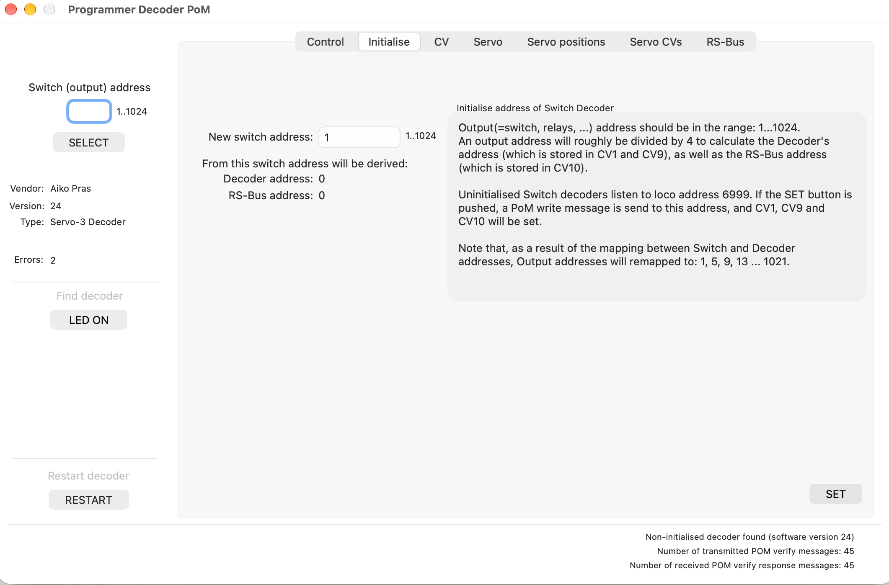
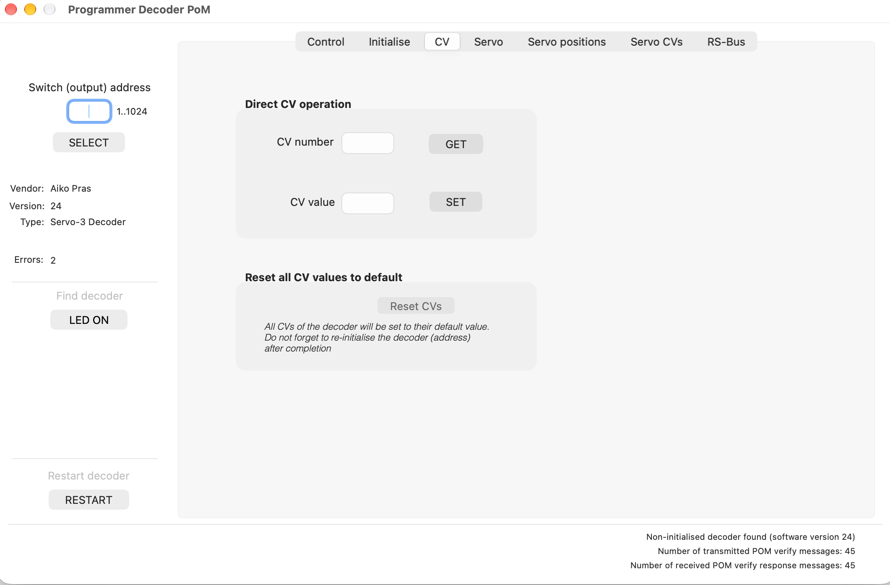
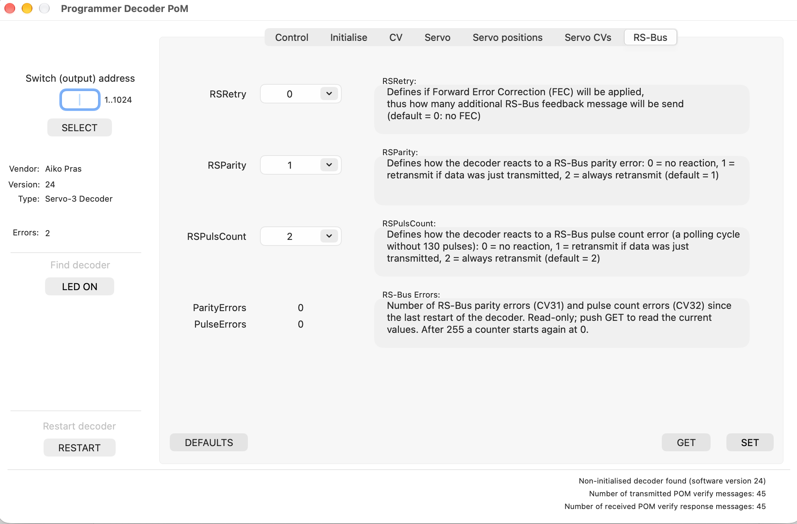
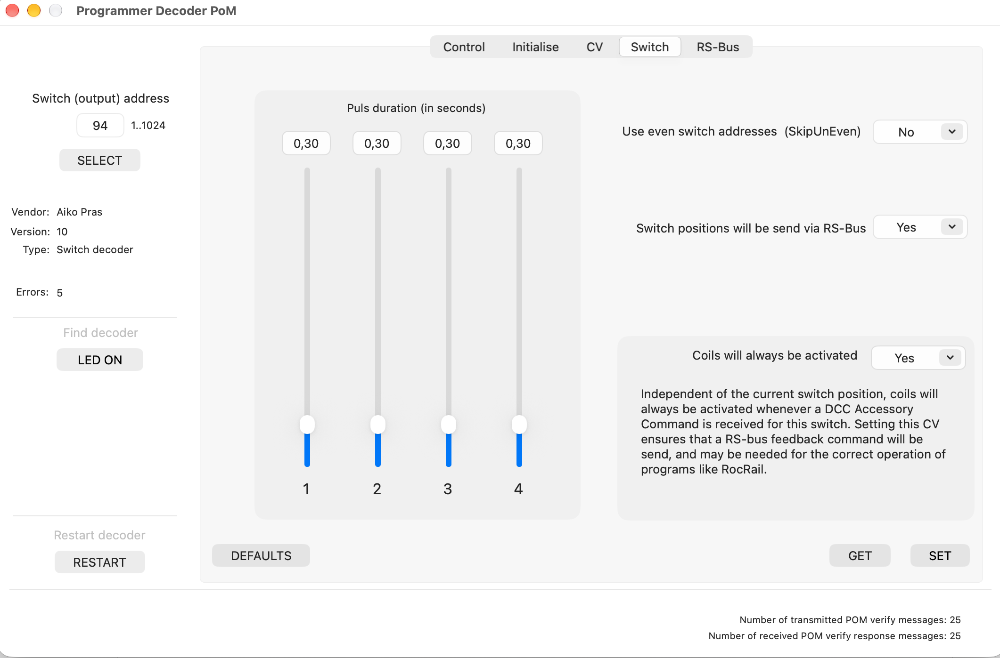
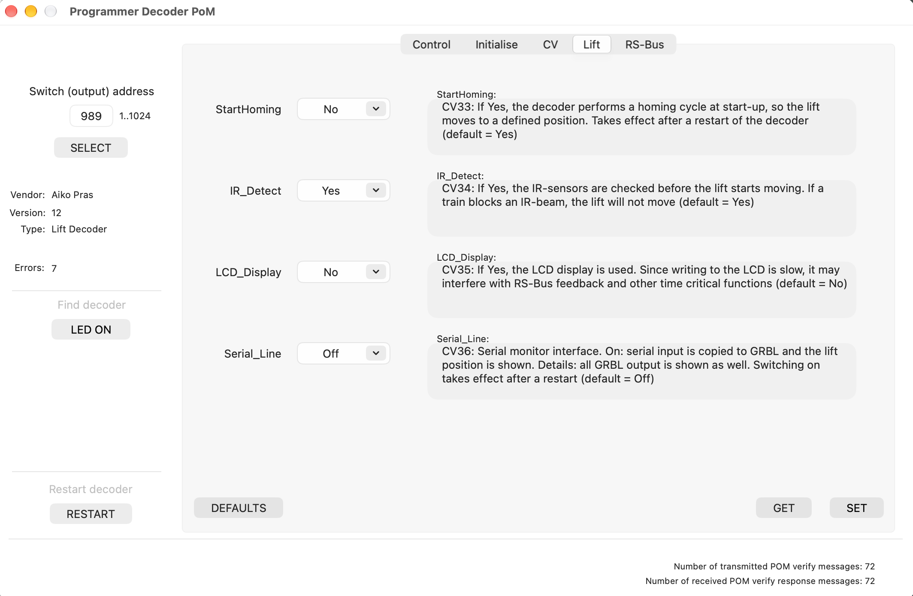
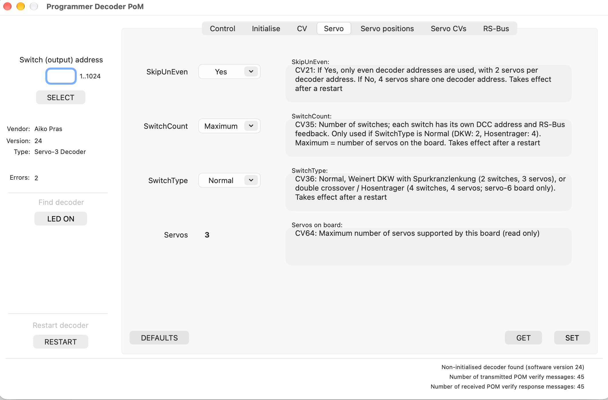
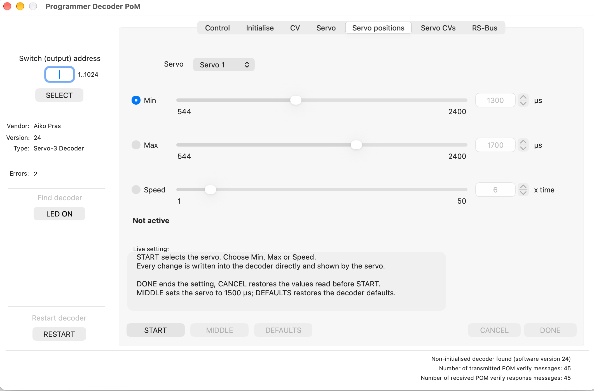
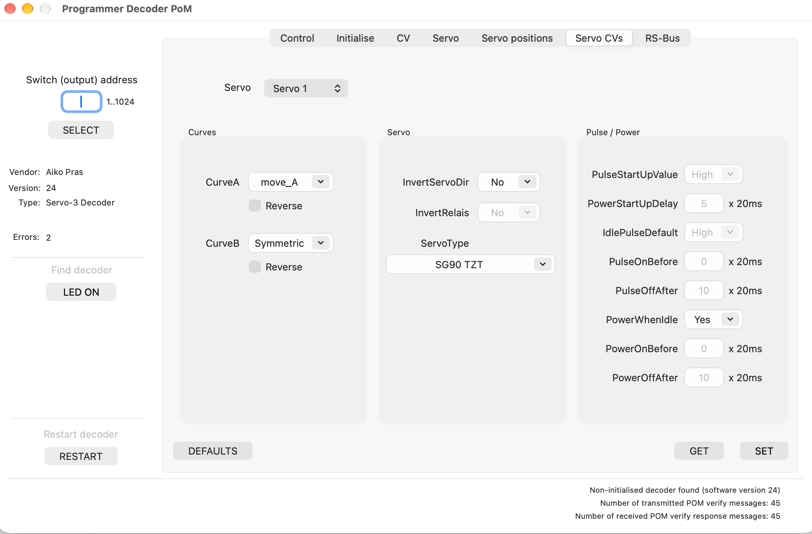
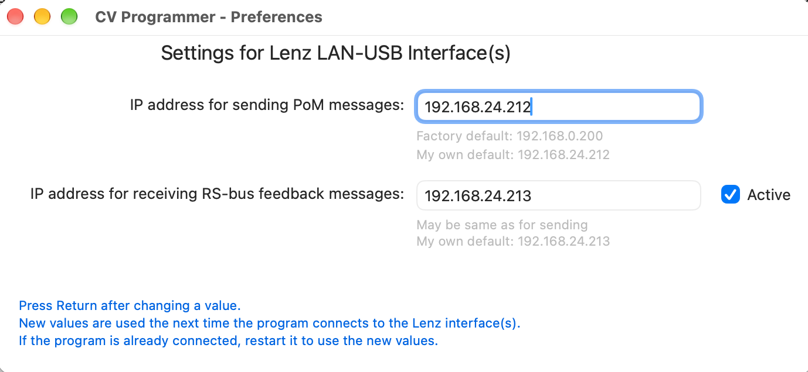

[🇬🇧 English](Manual.md) | [🇩🇪 Deutsch](Manual.de.md) | [🇳🇱 Nederlands](Manual.nl.md)

# Programmer-Decoder-POM – Handbuch
Zurück zur [README](../README.de.md). Alle CVs sind in den Hilfeseiten des Programms beschrieben (Menü Help, Englisch).

## Hauptfenster ##
- **Switch (output) address**: die Adresse des Decoders (1..1024, oder 1..2048 bei Zentralen mit Software 3.8 oder neuer). Return oder SELECT liest alle CVs des Decoders.
- **Leeres Adressfeld**: SELECT sucht einen noch nicht initialisierten Decoder. Wird einer gefunden, meldet die Statuszeile dies und der Reiter Initialise wird gezeigt.
- **Vendor, Version, Type, Errors**: aus dem Decoder gelesene Angaben; Errors ist die Anzahl der DCC-Prüfsummenfehler.
- **LED ON**: die LED des Decoders blinkt, um ihn auf der Anlage zu finden. **RESTART** startet den Decoder neu.

Die meisten Reiter haben die Tasten **DEFAULTS** (zeigt die Standardwerte), **GET** (liest die Werte aus dem Decoder) und **SET** (schreibt die Werte in den Decoder). Eine rote SET-Taste bedeutet: Werte geändert, aber noch nicht geschrieben.

## Reiter für alle Decoder ##
**Control**: RS-Bus-Wiederholungen (RSRetry), die Lenz-Adresskorrektur (Command System) und der Decodertyp.

**Initialise**: gibt einem noch nicht initialisierten Decoder seine Weichenadresse. Daraus werden die Decoderadresse (CV1, CV9) und die RS-Bus-Adresse (CV10) abgeleitet.

**CV**: liest oder schreibt eine einzelne CV, oder setzt alle CVs auf ihre Standardwerte zurück. Nach dem Zurücksetzen den Decoder erneut initialisieren.

**RS-Bus**: wie der Decoder mit RS-Bus-Fehlern umgeht (RSRetry, RSParity, RSPulsCount), und die Anzahl der Fehler seit dem letzten Neustart.

## Weichendecoder ##
**Switch**: die Impulsdauer pro Ausgang, die Verwendung nur gerader Weichenadressen (siehe [SkipUnEven](#skipuneven)), die RS-Bus-Rückmeldung der Weichenstellungen, und ob die Spulen immer angesteuert werden.

## Liftdecoder ##
**Lift**: StartHoming, IR_Detect, LCD_Display und Serial_Line (CV33..36).

## Servodecoder ##
**Servo**: zwei Servos pro Decoderadresse (siehe [SkipUnEven](#skipuneven)), die Anzahl der Weichen, der Weichentyp und die Anzahl der Servos auf der Platine.

**Servo positions**: stellt Min, Max und Speed eines Servos live ein: nach START zeigt das Servo jede Änderung sofort. DONE beendet das Einstellen, CANCEL stellt die alten Werte wieder her. Erfordert Decodersoftware Version 24 oder neuer.

**Servo CVs**: die Kurven, die Drehrichtung, der Servotyp und die Impuls- / Versorgungs-CVs eines Servos.

## Einstellungen ##
Die IP-Adresse(n) der Lenz LAN/USB-Interfaces: eine zum Senden der PoM-Befehle, und eine (darf dieselbe sein) zum Empfangen der RS-Bus-Rückmeldungen. macOS: Preferences im Programmmenü; Windows und Linux: File → Preferences. Die neuen Werte werden beim nächsten Verbindungsaufbau verwendet.

Die Einstellungen werden gespeichert in:
- macOS: `~/Library/Preferences/AikoPras.Programmer-Decoder-POM.plist`
- Windows: der Registry, `HKEY_CURRENT_USER\Software\Programmer Decoder-POM\Settings`
- Linux: `~/.config/Programmer Decoder-POM/Settings.conf`

## Logdatei ##
Die Windows- und Linux-Versionen schreiben Fehler, Warnungen und Verbindungsmeldungen der XpressNet-Verbindung(en) in `TMC-LogFile.txt` (ältere Logdateien: `TMC-LogFile-1..3.txt`):
- Windows: `%PUBLIC%\TMC-Logfiles` (meistens `C:\Users\Public\TMC-Logfiles`)
- Linux: `~/TMC-Logfiles`

Die macOS-Version schreibt keine Logdatei.

## SkipUnEven ##
Viele Programme zur Anlagensteuerung senden Weichenbefehle mit einer kurzen Pause dazwischen, während der RS-Bus die Stellungen mehrerer Weichen in einer Meldung zurückmeldet. Dadurch kann ein solches Programm schließen, dass eine Weiche nicht geschaltet hat, während ihr Befehl nur noch nicht gesendet wurde. Dies wird in [Feedback problems](details/FeedbackProblems.md) (Englisch) erklärt.

Das Problem tritt nicht auf, wenn jede Weiche ihre eigene Rückmeldung hat. Mit SkipUnEven (CV21) = 1 werden nur die geraden Weichenadressen (2, 4, 6, …) verwendet: der Reiter Switch nennt dies „Use even switch addresses“, und beim Reiter Servo bedeutet es zwei Servos pro Decoderadresse statt vier. Jeder Decoder belegt dann doppelt so viele Adressen.
