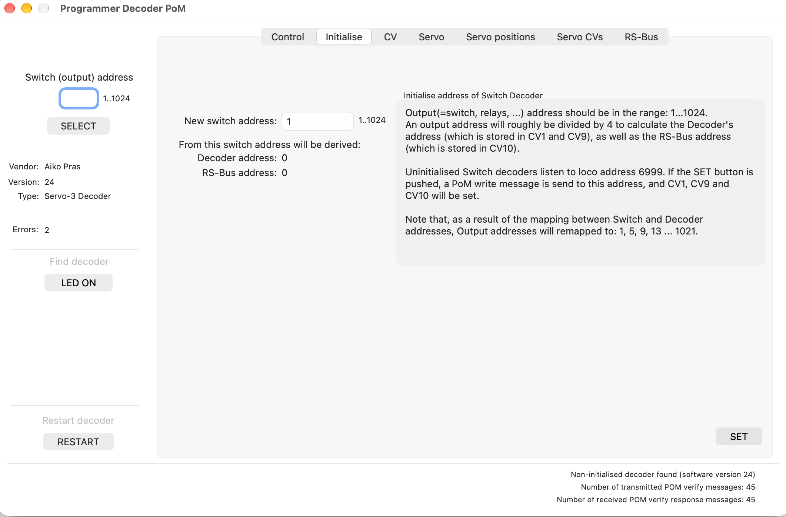
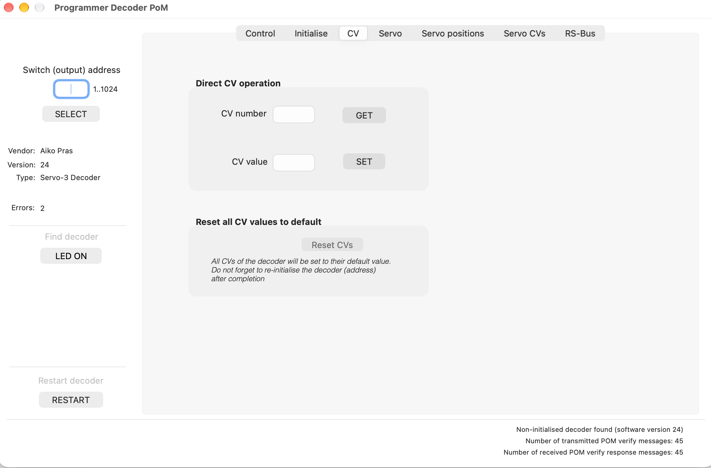
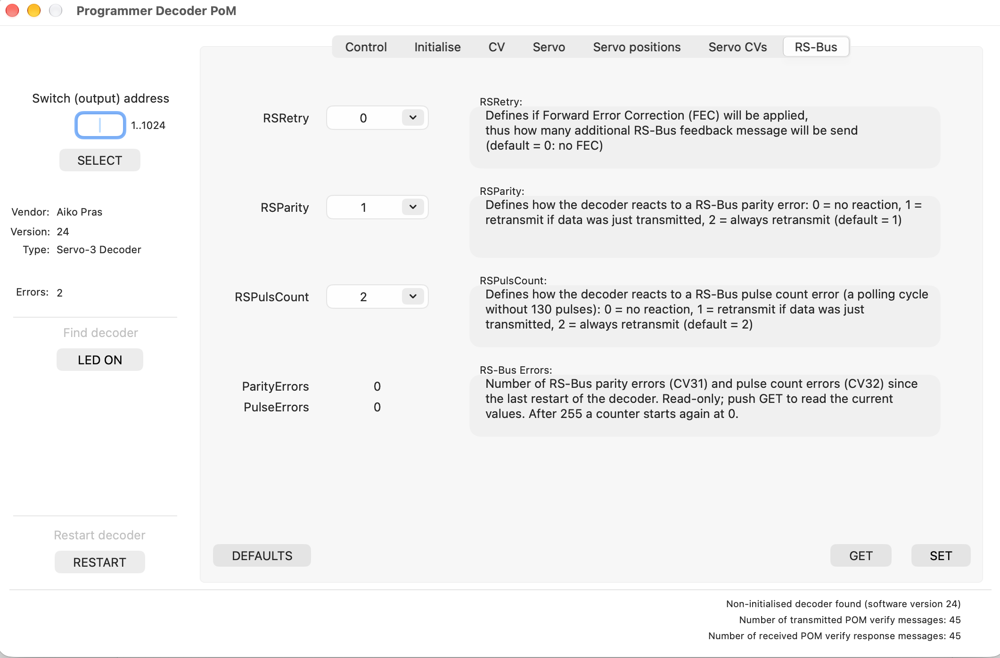
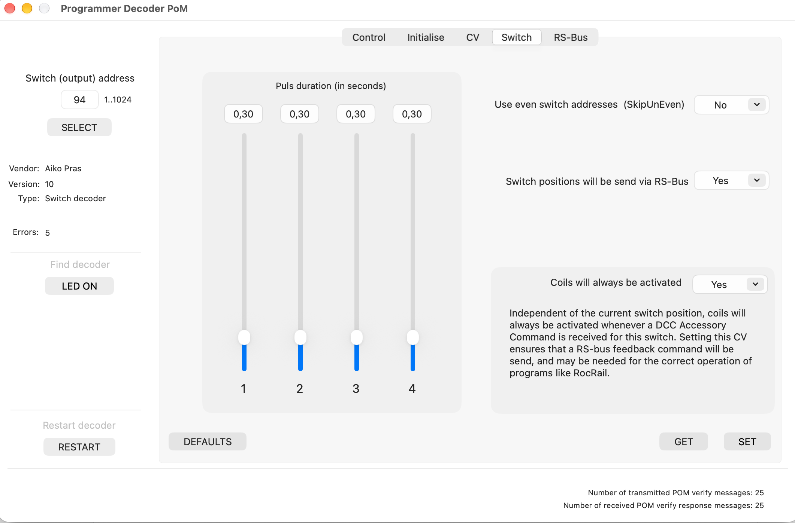
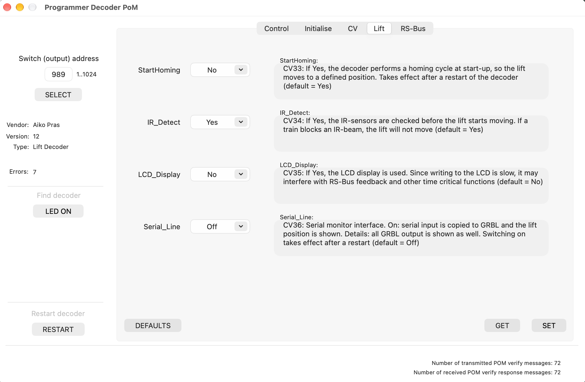
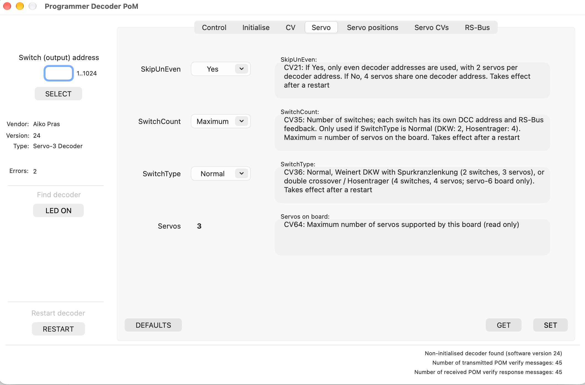
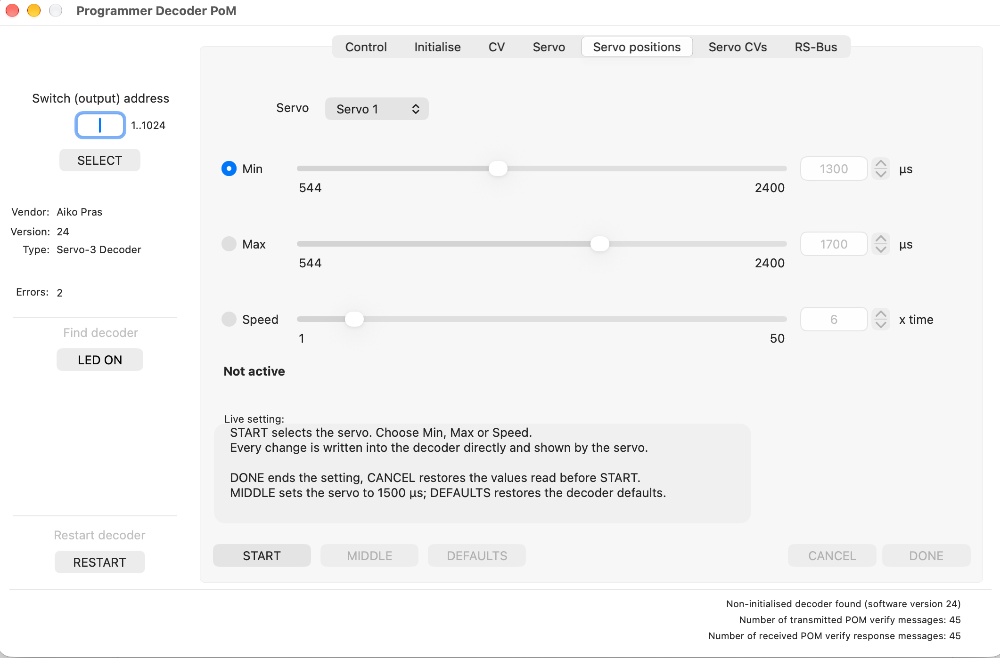
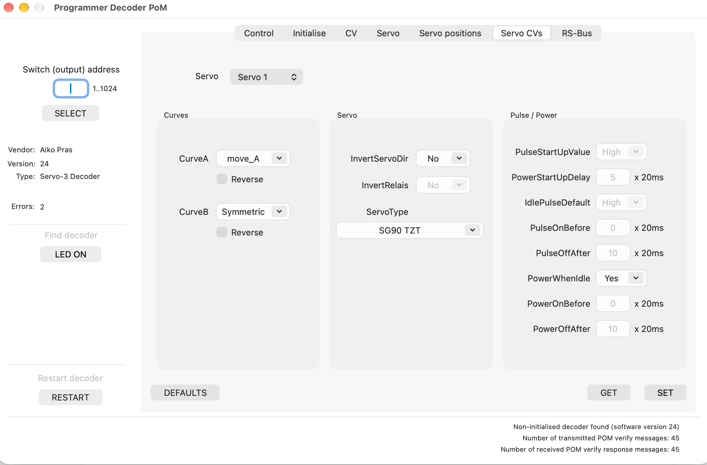
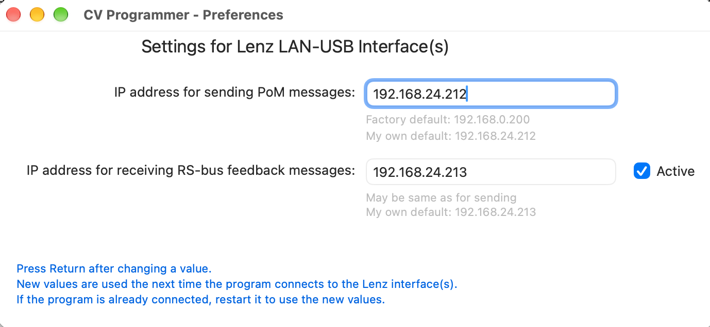

[🇬🇧 English](Manual.md) | [🇩🇪 Deutsch](Manual.de.md) | [🇳🇱 Nederlands](Manual.nl.md)

# Programmer-Decoder-POM – Manual
Back to the [README](../README.md). All CVs are described in the help pages of the program (menu Help).

## Main window ##
- **Switch (output) address**: the address of the decoder (1..1024, or 1..2048 for command stations with software 3.8 or higher). Press Return or SELECT to read all CVs of the decoder.
- **Empty address field**: SELECT searches for a decoder that is not yet initialised. If one is found, the status line says so and the Initialise tab is shown.
- **Vendor, Version, Type, Errors**: information read from the decoder; Errors is the number of DCC checksum errors.
- **LED ON**: the LED of the decoder blinks, to find it on the layout. **RESTART** restarts the decoder.

Most tabs have the buttons **DEFAULTS** (shows the default values), **GET** (reads the values from the decoder) and **SET** (writes the values to the decoder). A red SET button means: values changed, but not yet written.

## Tabs for all decoders ##
**Control**: RS-Bus retransmissions (RSRetry), the Lenz address correction (Command System) and the decoder type.

**Initialise**: gives a decoder that is not yet initialised its switch address. The decoder address (CV1, CV9) and the RS-Bus address (CV10) are derived from it.

**CV**: reads or writes a single CV, or resets all CVs to their default values. After a reset, initialise the decoder again.

**RS-Bus**: how the decoder handles RS-Bus errors (RSRetry, RSParity, RSPulsCount), and the number of errors since the last restart.

## Switch decoder ##
**Switch**: the pulse duration per output, the use of even switch addresses only (see [SkipUnEven](#skipuneven)), RS-Bus feedback of the switch positions, and whether coils are always activated.

## Lift decoder ##
**Lift**: StartHoming, IR_Detect, LCD_Display and Serial_Line (CV33..36).

## Servo decoders ##
**Servo**: two servos per decoder address (see [SkipUnEven](#skipuneven)), the number of switches, the switch type and the number of servos on the board.

**Servo positions**: sets Min, Max and Speed of one servo live: after START the servo shows every change directly. DONE ends the setting, CANCEL restores the old values. Requires decoder software version 24 or higher.

**Servo CVs**: the curves, the direction, the servo type and the pulse / power CVs of one servo.

## Preferences ##
The IP address(es) of the Lenz LAN/USB interface(s): one for sending PoM messages, and one (may be the same) for receiving the RS-Bus feedback. macOS: Preferences in the program menu; Windows and Linux: File → Preferences. The new values are used the next time the program connects.

The preferences are stored in:
- macOS: `~/Library/Preferences/AikoPras.Programmer-Decoder-POM.plist`
- Windows: the registry, `HKEY_CURRENT_USER\Software\Programmer Decoder-POM\Settings`
- Linux: `~/.config/Programmer Decoder-POM/Settings.conf`

## Logfile ##
The Windows and Linux versions write errors, warnings and connection messages of the XpressNet connection(s) to `TMC-LogFile.txt` (older logfiles: `TMC-LogFile-1..3.txt`):
- Windows: `%PUBLIC%\TMC-Logfiles` (usually `C:\Users\Public\TMC-Logfiles`)
- Linux: `~/TMC-Logfiles`

The macOS version writes no logfile.

## SkipUnEven ##
Many programs that control a layout send switch commands with a short delay between them, while the RS-Bus reports the positions of several switches in one message. As a result such a program may conclude that a switch has failed, while its command simply has not been sent yet. This is explained in [Feedback problems](details/FeedbackProblems.md).

The problem does not occur if each switch has its own feedback. With SkipUnEven (CV21) = 1 only the even switch addresses (2, 4, 6, …) are used: the Switch tab calls this "Use even switch addresses", and on the Servo tab it means two servos per decoder address instead of four. Each decoder then uses twice as many addresses.
