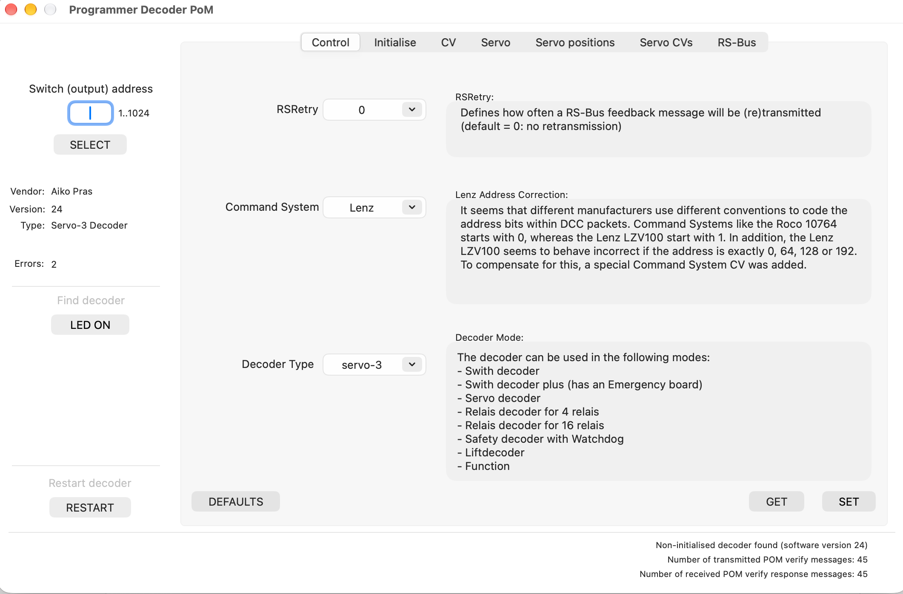
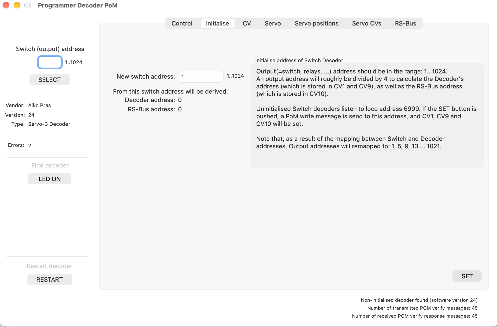
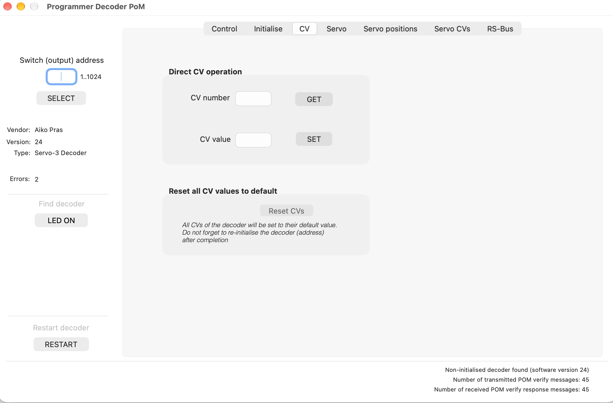
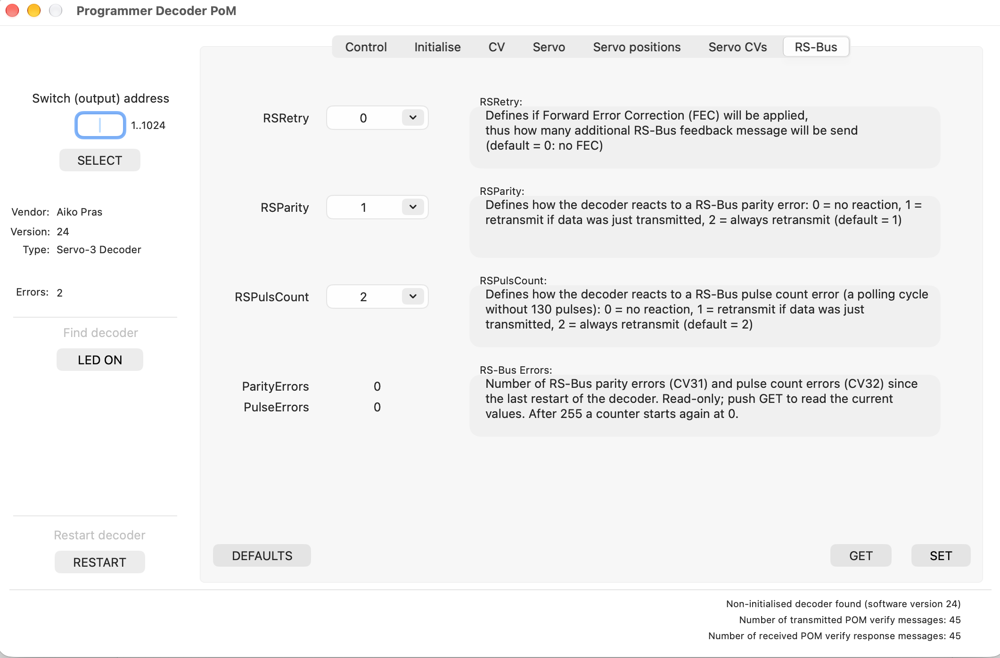
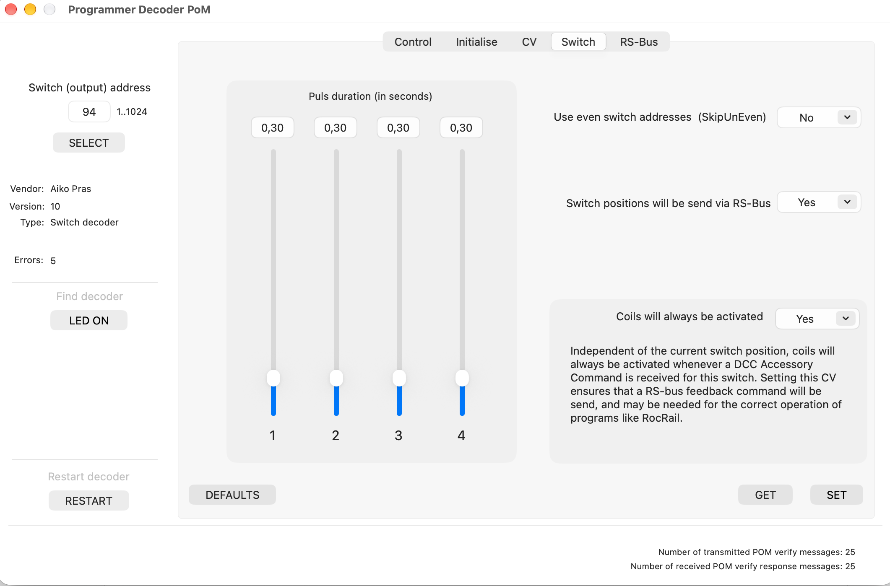
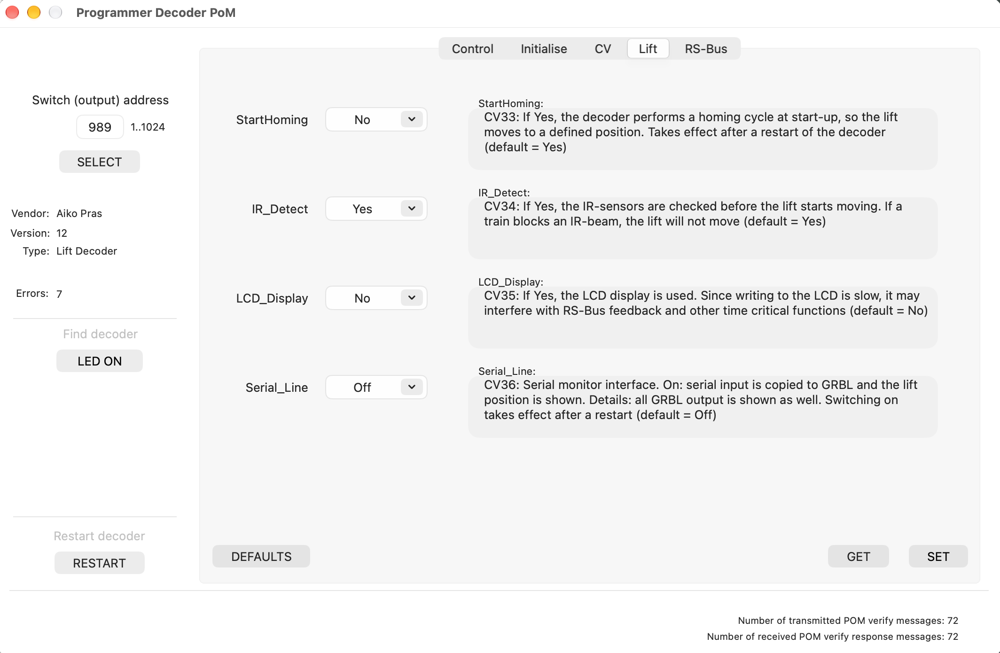
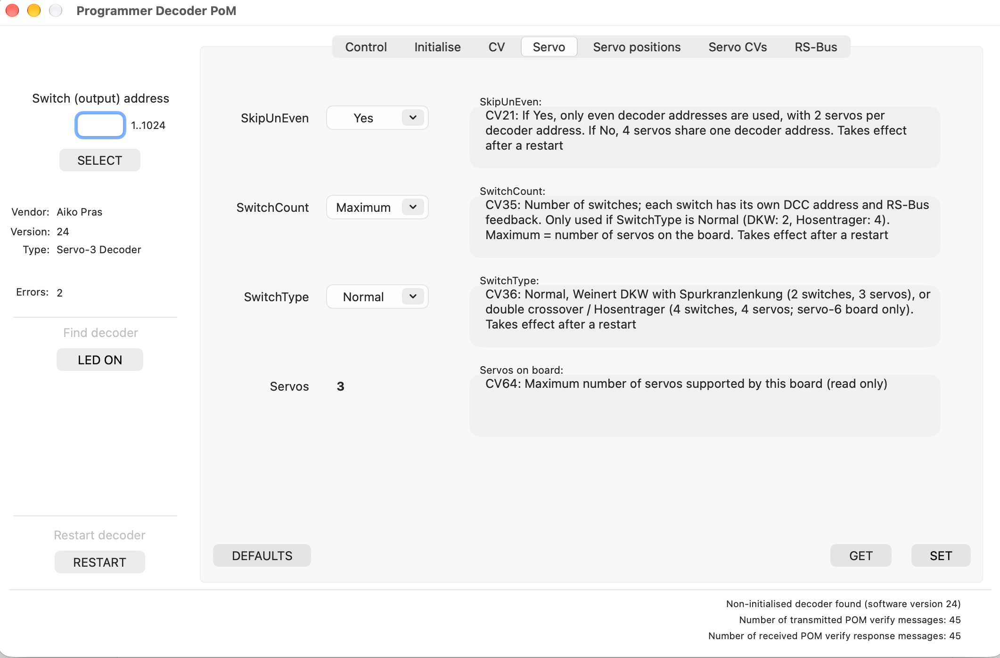
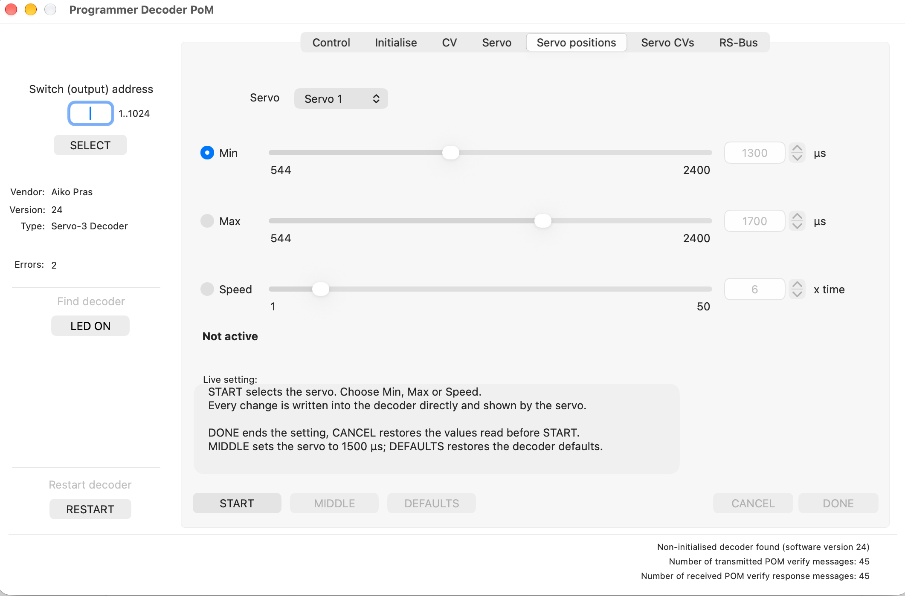
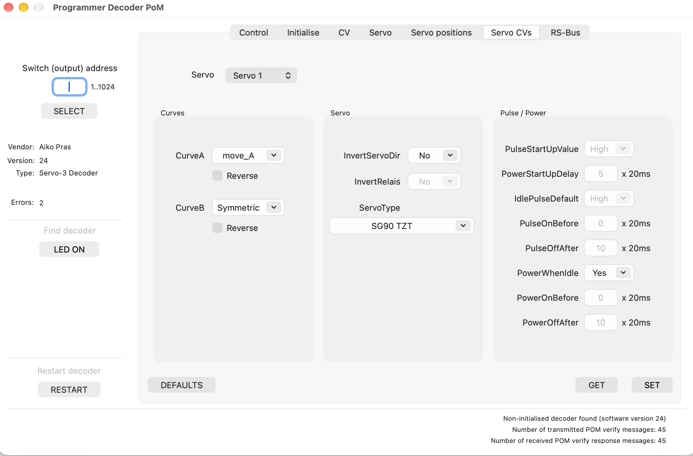
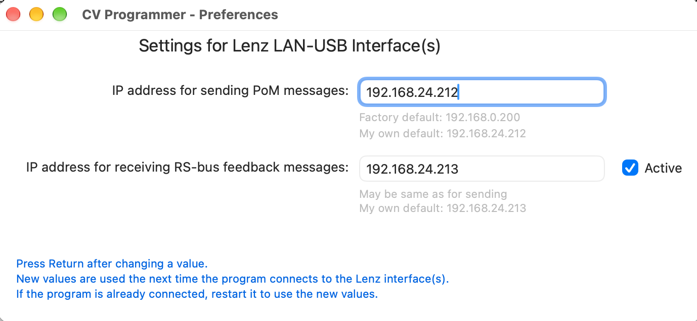

[🇬🇧 English](Manual.md) | [🇩🇪 Deutsch](Manual.de.md) | [🇳🇱 Nederlands](Manual.nl.md)

# Programmer-Decoder-POM – Handleiding
Terug naar de [README](../README.nl.md). Alle CV's staan beschreven in de helppagina's van het programma (menu Help, Engels).

## Hoofdscherm ##
- **Switch (output) address**: het adres van de decoder (1..1024, of 1..2048 bij centrales met software 3.8 of nieuwer). Return of SELECT leest alle CV's van de decoder.
- **Leeg adresveld**: SELECT zoekt een decoder die nog niet geïnitialiseerd is. Wordt er een gevonden, dan meldt de statusregel dat en wordt de tab Initialise getoond.
- **Vendor, Version, Type, Errors**: gegevens die uit de decoder gelezen zijn; Errors is het aantal DCC-checksumfouten.
- **LED ON**: de LED van de decoder knippert, om hem op de baan te vinden. **RESTART** herstart de decoder.

De meeste tabs hebben de knoppen **DEFAULTS** (toont de standaardwaarden), **GET** (leest de waarden uit de decoder) en **SET** (schrijft de waarden naar de decoder). Een rode SET-knop betekent: waarden gewijzigd, maar nog niet geschreven.

## Tabs voor alle decoders ##
**Control**: RS-Bus-herhalingen (RSRetry), de Lenz-adrescorrectie (Command System) en het decodertype.

**Initialise**: geeft een nog niet geïnitialiseerde decoder zijn wisseladres. Daaruit worden het decoderadres (CV1, CV9) en het RS-Bus-adres (CV10) afgeleid.

**CV**: leest of schrijft één CV, of zet alle CV's terug naar hun standaardwaarden. Initialiseer de decoder daarna opnieuw.

**RS-Bus**: hoe de decoder met RS-Bus-fouten omgaat (RSRetry, RSParity, RSPulsCount), en het aantal fouten sinds de laatste herstart.

## Wisseldecoder ##
**Switch**: de pulsduur per uitgang, het gebruik van alleen even wisseladressen (zie [SkipUnEven](#skipuneven)), de RS-Bus-terugmelding van de wisselstanden, en of de spoelen altijd bekrachtigd worden.

## Liftdecoder ##
**Lift**: StartHoming, IR_Detect, LCD_Display en Serial_Line (CV33..36).

## Servodecoders ##
**Servo**: twee servo's per decoderadres (zie [SkipUnEven](#skipuneven)), het aantal wissels, het wisseltype en het aantal servo's op de print.

**Servo positions**: stelt Min, Max en Speed van één servo live in: na START toont de servo elke wijziging direct. DONE beëindigt het instellen, CANCEL zet de oude waarden terug. Vereist decodersoftware versie 24 of hoger.

**Servo CVs**: de curves, de draairichting, het servotype en de puls- / voedings-CV's van één servo.

## Voorkeuren ##
De IP-adres(sen) van de Lenz LAN/USB-interface(s): één voor het versturen van de PoM-berichten, en één (mag dezelfde zijn) voor het ontvangen van de RS-Bus-terugmeldingen. macOS: Preferences in het programmamenu; Windows en Linux: File → Preferences. De nieuwe waarden worden gebruikt bij de volgende verbinding.

De voorkeuren worden bewaard in:
- macOS: `~/Library/Preferences/AikoPras.Programmer-Decoder-POM.plist`
- Windows: het register, `HKEY_CURRENT_USER\Software\Programmer Decoder-POM\Settings`
- Linux: `~/.config/Programmer Decoder-POM/Settings.conf`

## Logfile ##
De Windows- en Linux-versies schrijven fouten, waarschuwingen en verbindingsmeldingen van de XpressNet-verbinding(en) naar `TMC-LogFile.txt` (oudere logfiles: `TMC-LogFile-1..3.txt`):
- Windows: `%PUBLIC%\TMC-Logfiles` (meestal `C:\Users\Public\TMC-Logfiles`)
- Linux: `~/TMC-Logfiles`

De macOS-versie schrijft geen logfile.

## SkipUnEven ##
Veel programma's die een baan besturen sturen wisselcommando's met een korte pauze ertussen, terwijl de RS-Bus de standen van meerdere wissels in één bericht terugmeldt. Daardoor kan zo'n programma concluderen dat een wissel niet omgezet is, terwijl zijn commando alleen nog niet verstuurd is. Dit wordt uitgelegd in [Feedback problems](details/FeedbackProblems.md) (Engels).

Het probleem treedt niet op als elke wissel zijn eigen terugmelding heeft. Met SkipUnEven (CV21) = 1 worden alleen de even wisseladressen (2, 4, 6, …) gebruikt: de tab Switch noemt dit "Use even switch addresses", en op de tab Servo betekent het twee servo's per decoderadres in plaats van vier. Elke decoder gebruikt dan twee keer zoveel adressen.
