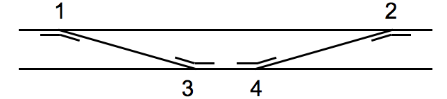
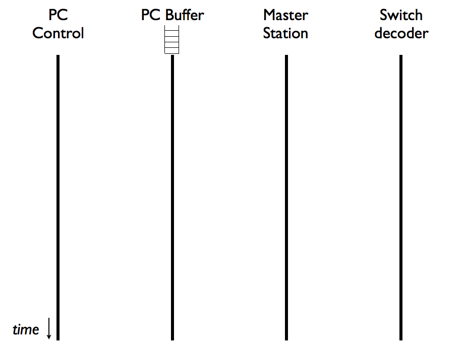
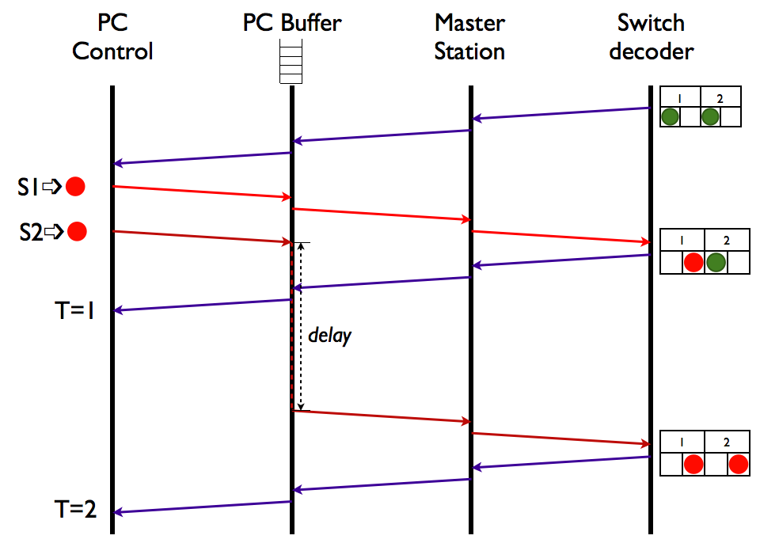

# Feedback problems
Back to the [Manual](../Manual.md).

On Internet fora and in vendors' FAQs you often read that feedback of switch positions is unreliable. But what exactly makes switch feedback unreliable, and can it be made reliable? To answer this, we have to dive a bit deeper into the details of feedback systems.

## Example ##
Assume we have a layout with four switches, as shown in the figure below. The switches have DCC addresses 1 to 4. The switches have a certain relationship: if switch 1 is straight (the train stays on the upper track), switch 2 should be straight as well.

The following time-sequence diagram explains what happens if the system is powered on and the computer program that controls the layout changes the position of switches 1 and 2. From left to right the diagram shows the computer program that controls the layout (for example Train Controller), a buffer that is part of that program (explained below), the master station (for example the Lenz LZV 100) and the switch decoder (for example OpenDecoder 2.2) that controls the four switches.

Vertically the diagram shows the time; in our example the difference between start and end time may be less than a second. With such short times, the scenario below only occurs if the layout is controlled by a computer program. A human being, pushing buttons on a hand-held controller (such as the Lenz LH 100), is usually too slow.

## Role of the buffer ##
If a switch engine is activated, the current through its coil can reach 0.5 to 1 Ampere for a short period (tenths to hundreds of milliseconds). If ten switches are activated simultaneously, the transformer must deliver 5 to 10 Amperes. In most cases it can not; it may signal a short circuit, and some switches may not change their position.

To avoid such high currents, programs that control a layout generally introduce a short delay between the switch commands, typically 250 milliseconds. If ten switches should be activated at the same time, the first command is performed immediately, the second after 250 milliseconds, the third after 500 milliseconds, and so on. Usually one process of the program controls the layout (it monitors the switch positions and generates the commands to change them), and another process buffers the switch commands and introduces the delays. The time-sequence diagram shows these two processes separately.

## RS-Bus scenario ##

After power on, the switch decoder sends the actual switch positions to the master station, which forwards them to the PC. Several feedback systems, including the RS-Bus, send multiple switch positions in a single feedback message. In the diagram the switch decoder reports in a single message that switches 1 and 2 are both green (blue arrows at the top).

The control process on the PC now changes both switch 1 and switch 2 to red. For this it issues two DCC commands, one per switch (the DCC specification does not allow to change multiple switches with a single command). The two commands follow each other within milliseconds. The buffer forwards the first command immediately, but holds the second one for about 250 milliseconds. The first command therefore arrives at the switch decoder more or less immediately; the second one 250 milliseconds later.

The switch decoder executes the first command and sends a feedback message: switch 1 is now red, but switch 2 is still green, since its command has not yet arrived. The control process receives this message at T=1, around 100 milliseconds after the commands were issued. Many programs now conclude that switch 1 has changed successfully, but also (wrongly) that switch 2 has failed. Depending on the program an error is raised, and switch 2 may get blocked. Most programs do not realise that the second command was buffered, and that a conclusion about switch 2 should wait until T=2.

Such intelligence is not easy to implement: the program would have to know the details of many command systems (DCC, MM, Selectrix) and feedback systems (RS-Bus, LocoNet, S88, etc.), handle error situations, and take different switching times into account (switch engines with servos or DC motors may take seconds, coil based switch engines tenths of milliseconds).

Strictly speaking, RS-Bus messages are only exchanged between the switch decoder and the master station. The master station translates them into XpressNet messages with the same content, and forwards these to the PC.

## XpressNet scenario ##
Similar problems occur with other feedback buses, such as the feedback bus of OpenDecoder v2. That bus uses a separate message for each switch position, but the command station communicates with the PC via XpressNet (or another protocol), and XpressNet also sends multiple feedback signals in a single message. When a switch decoder reports a new switch position, the master station sends it to the PC together with the stored positions of other switches.

## Avoiding switch feedback problems ##
There are several possibilities to avoid these problems:
1. A more intelligent PC program. In practice this may not be feasible.
2. New hardware, based on better protocols. Such hardware must still communicate with the existing PC programs, so the protocol between master station and PC can not change. This is hardly feasible either.
3. Assign the switch addresses in such a way that the problem can not occur: use only the uneven (1, 3, 5, …) or only the even (2, 4, 6, …) switch addresses. Only half of the address space is then available, which is often acceptable. If needed, some programs can use multiple command stations and feedback buses.

The third possibility doubles the number of switch decoders: each decoder then controls two switches instead of four. The software of my decoders therefore has an option to use only the even switch addresses: set CV21 (SkipUnEven) to 1. In Programmer-Decoder-POM this is "Use even switch addresses (SkipUnEven)" on the Switch tab, and SkipUnEven on the Servo tab (two servos per decoder address).
