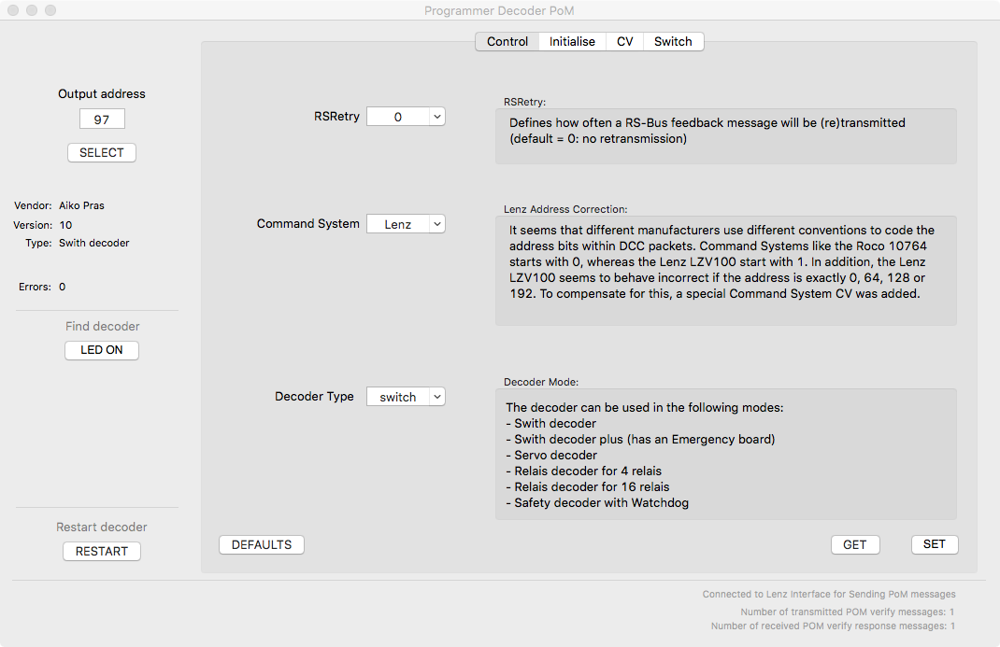
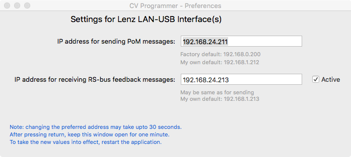

# Programmer-Decoder-POM (EN)
Software to configure the DCC accessory decoders with RS-Bus feedback: switch, relays, lift and servo decoders.

This program allows the initialisation (by reading and modifying CV variables) of the [switch decoders](https://github.com/aikopras/OPENDECODER22) and of the decoders based on the [AP_DCC_Decoder_Core](https://github.com/aikopras/AP_DCC_Decoder_Core) library. These decoders can be used to change the position of switches, relays and servos. Any changes regarding the position of switches will be send back to the master station via RS-Bus messages. Given that it uses RS-Bus messages for feedback, the decoders will primarily be interesting in environments with LENZ Master stations (like the LZV 100) connected via the LAN/USB interface (23151).

| Version | Language | Status | Installation and building |
|---|---|---|---|
| [macOS](macOS) | Objective-C (Xcode) | available | [macOS/README.md](macOS/README.md) |
| Windows | | planned | |
| Linux | | planned | |

The changes per version are described in the [Version history](Version_History.md).

## Main screen ##
After startup the program shows its main screen. After entering the current Switch address of the decoder all CV values are being downloaded from the decoder. Depending on the decoder type, the program shows the Switch tab, the Lift tab or the three Servo tabs.

Screenshots of the tabs: [Control](/Documentation/Screenshots/Control.png), [Initialise](/Documentation/Screenshots/Initialise.png), [CV](/Documentation/Screenshots/CV.png), [Switch](/Documentation/Screenshots/Switch.png), [Lift](/Documentation/Screenshots/Lift.png), [Servo](/Documentation/Screenshots/Servo.png), [Servo positions](/Documentation/Screenshots/Servo-positions.png), [Servo CVs](/Documentation/Screenshots/Servo-CVs.png) and the [Preferences](/Documentation/Screenshots/Preferences.png).

## How does the program work? ##
To initialise and modify the decoder's Configuration Variables (CVs) the program sends Programming on the Main (PoM) messages. Since the XPressNet specification supports PoM messages only for train decoders (but not for accessory / feedback decoders), the "trick" the Switch decoder uses is to listen to the loco address equal to the <I>Decoder address + 6999</I>. 
The requested CV values are send back via the RS-Bus.

The program communicates with the LENZ Master station via the LAN/USB interface (23151). If different master stations are used for DCC commands and RS-Bus feedback messages, two LAN/USB interfaces may be used. The IP address(es) of the LAN interfaces can be entered via the program preferences. 

## Servo decoders ##
On the Servo positions tab the end positions (Min and Max) and the Speed of one servo can be set live: the servo shows every change directly. This requires decoder software version 24 or higher.

Advised setting of PowerWhenIdle (Servo CVs tab):
- servo-2 and servo-6 boards: No for all ServoTypes.
- servo-3 board: Yes for the ServoTypes Generic and Uhlenbrock 81420 / Weinert (with No these servos do not always work reliably on this board); No for the other ServoTypes.

The DEFAULTS button of the Servo CVs tab sets ServoType Generic, with PowerWhenIdle according to these rules. Changing the ServoType does not change PowerWhenIdle.

---

# Programmer-Decoder-POM (DE)
Software zur Konfiguration der DCC-Zubehördecoder mit RS-Bus-Rückmeldung: Weichen-, Relais-, Lift- und Servodecoder.

Mit diesem Programm können die [Weichendecoder](https://github.com/aikopras/OPENDECODER22) und die Decoder auf Basis der Bibliothek [AP_DCC_Decoder_Core](https://github.com/aikopras/AP_DCC_Decoder_Core) eingestellt werden, indem ihre CVs gelesen und geändert werden. Mit diesen Decodern lassen sich Weichen, Relais und Servos stellen. Jede Änderung der Weichenstellung wird über RS-Bus-Meldungen an die Zentrale zurückgemeldet. Da die Rückmeldung über den RS-Bus erfolgt, sind die Decoder vor allem für Anlagen mit LENZ-Zentralen (wie der LZV 100) interessant, die über das LAN/USB-Interface (23151) angeschlossen sind.

| Version | Sprache | Status | Installation und Übersetzen |
|---|---|---|---|
| [macOS](macOS) | Objective-C (Xcode) | verfügbar | [macOS/README.md](macOS/README.md) |
| Windows | | geplant | |
| Linux | | geplant | |

Die Änderungen pro Version stehen in der [Versionsgeschichte](Versionsgeschichte.md).

## Hauptfenster ##
Nach dem Start zeigt das Programm sein Hauptfenster. Nach Eingabe der aktuellen Weichenadresse des Decoders werden alle CV-Werte aus dem Decoder gelesen. Je nach Decodertyp zeigt das Programm den Reiter Switch, den Reiter Lift oder die drei Servo-Reiter.

Screenshots der Reiter: siehe oben (EN).

## Wie funktioniert das Programm? ##
Zum Einstellen und Ändern der CVs des Decoders sendet das Programm PoM-Befehle (Programming on the Main). Da die XpressNet-Spezifikation PoM-Befehle nur für Lokdecoder vorsieht (nicht für Zubehör- oder Rückmeldedecoder), hört der Weichendecoder als „Trick“ auf die Lokadresse <I>Decoderadresse + 6999</I>. 
Die angefragten CV-Werte werden über den RS-Bus zurückgemeldet.

Das Programm kommuniziert mit der LENZ-Zentrale über das LAN/USB-Interface (23151). Werden für DCC-Befehle und RS-Bus-Rückmeldungen verschiedene Zentralen verwendet, können zwei LAN/USB-Interfaces benutzt werden. Die IP-Adresse(n) der LAN-Interfaces werden in den Einstellungen des Programms eingegeben.

## Servodecoder ##
Auf dem Reiter Servo positions können die Endlagen (Min und Max) und die Geschwindigkeit (Speed) eines Servos live eingestellt werden: Der Servo zeigt jede Änderung sofort. Dafür ist die Decodersoftware ab Version 24 nötig.

Empfohlene Einstellung von PowerWhenIdle (Reiter Servo CVs):
- Servo-2- und Servo-6-Platine: No für alle ServoTypes.
- Servo-3-Platine: Yes für die ServoTypes Generic und Uhlenbrock 81420 / Weinert (mit No arbeiten diese Servos auf dieser Platine nicht immer zuverlässig); No für die übrigen ServoTypes.

Die Taste DEFAULTS auf dem Reiter Servo CVs setzt ServoType Generic, mit PowerWhenIdle nach diesen Regeln. Eine Änderung des ServoType ändert PowerWhenIdle nicht.

---

# Programmer-Decoder-POM (NL)
Software om de DCC-accessorydecoders met RS-Bus-terugmelding in te stellen: wissel-, relais-, lift- en servodecoders.

Met dit programma kunnen de [wisseldecoders](https://github.com/aikopras/OPENDECODER22) en de decoders die gebaseerd zijn op de library [AP_DCC_Decoder_Core](https://github.com/aikopras/AP_DCC_Decoder_Core) ingesteld worden, door hun CV's te lezen en te wijzigen. Met deze decoders kunnen wissels, relais en servo's worden omgezet. Elke wijziging in de stand van een wissel wordt via RS-Bus-berichten teruggemeld aan de centrale. Omdat de terugmelding via de RS-Bus gaat, zijn de decoders vooral interessant voor banen met LENZ-centrales (zoals de LZV 100) die via de LAN/USB-interface (23151) zijn aangesloten.

| Versie | Taal | Status | Installatie en bouwen |
|---|---|---|---|
| [macOS](macOS) | Objective-C (Xcode) | beschikbaar | [macOS/README.md](macOS/README.md) |
| Windows | | gepland | |
| Linux | | gepland | |

De wijzigingen per versie staan in de [Versiegeschiedenis](Versiegeschiedenis.md).

## Hoofdscherm ##
Na het opstarten toont het programma zijn hoofdscherm. Na het invoeren van het huidige wisseladres van de decoder worden alle CV-waarden uit de decoder gelezen. Afhankelijk van het decodertype toont het programma de tab Switch, de tab Lift of de drie Servo-tabs.

Screenshots van de tabs: zie hierboven (EN).

## Hoe werkt het programma? ##
Om de CV's van de decoder in te stellen en te wijzigen, stuurt het programma PoM-berichten (Programming on the Main). Omdat de XpressNet-specificatie PoM-berichten alleen voor locdecoders kent (niet voor accessory- of terugmelddecoders), luistert de wisseldecoder als "truc" naar het locadres <I>decoderadres + 6999</I>. 
De gevraagde CV-waarden worden via de RS-Bus teruggemeld.

Het programma communiceert met de LENZ-centrale via de LAN/USB-interface (23151). Worden voor DCC-commando's en RS-Bus-terugmeldingen verschillende centrales gebruikt, dan kunnen twee LAN/USB-interfaces worden gebruikt. De IP-adres(sen) van de LAN-interfaces worden ingevoerd via de voorkeuren van het programma.

## Servodecoders ##
Op de tab Servo positions kunnen de eindstanden (Min en Max) en de snelheid (Speed) van één servo live ingesteld worden: de servo laat elke wijziging direct zien. Daarvoor is decodersoftware vanaf versie 24 nodig.

Geadviseerde instelling van PowerWhenIdle (tab Servo CVs):
- servo-2- en servo-6-board: No voor alle ServoTypes.
- servo-3-board: Yes voor de ServoTypes Generic en Uhlenbrock 81420 / Weinert (met No werken deze servo's op dit board niet altijd betrouwbaar); No voor de overige ServoTypes.

De knop DEFAULTS op de tab Servo CVs zet ServoType Generic, met PowerWhenIdle volgens deze regels. Een andere ServoType verandert PowerWhenIdle niet.
